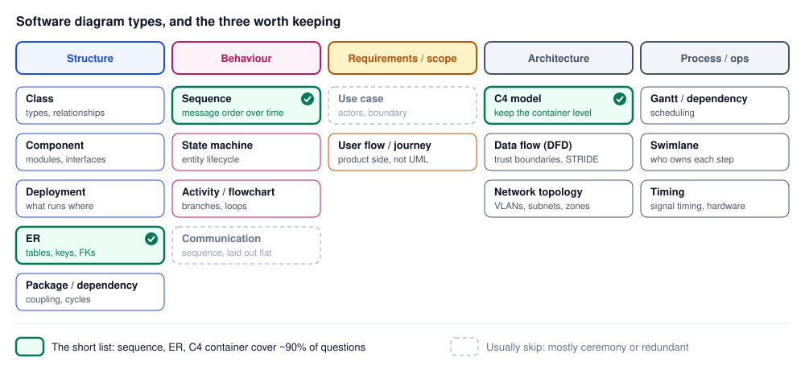

# Diagrams

Diagram types

Author

Benedict Thekkel

Software diagram types grouped into structure, behaviour, requirements, architecture and process, with sequence, ER and C4 container marked as the short list

**Structure** - **Class diagram** (UML) — types, fields, relationships. Useful for domain models; usually redundant if you have the code. - **Component diagram** — services/modules and their interfaces. - **Deployment diagram** — what runs on what hardware/host. - **ER diagram** — tables, columns, FK relationships. Highest value-per-effort of the structural ones. - **Package/dependency diagram** — module coupling, cycle detection.

**Behaviour** - **Sequence diagram** — message ordering between participants over time. The single most useful UML diagram for real work: auth flows, webhook handling, distributed calls. - **State machine diagram** — entity lifecycle (order status, subscription state). Worth drawing whenever you’re about to write a big `if status ==` block. - **Activity diagram / flowchart** — control flow, branching logic. - **Communication diagram** — same info as a sequence diagram, laid out spatially. Skip it.

**Requirements / scope** - **Use case diagram** — actors and system boundaries. Mostly ceremony. - **User flow / journey map** — product-side, not UML.

**Architecture (non-UML, and generally better)** - **C4 model** — Context → Container → Component → Code. The pragmatic replacement for most UML architecture diagrams. - **Data flow diagram (DFD)** — where data moves and crosses trust boundaries; the basis for STRIDE threat modelling. - **Network topology diagram** — VLANs, subnets, firewall zones.

**Process / ops** - **Gantt / dependency chart** — scheduling. - **Swimlane diagram** — responsibility across teams or systems. - **Timing diagram** — signal timing; relevant on the hardware side.

If you’re only going to keep three: sequence, ER, and C4 container. Those cover “how does this interaction work”, “what’s the data shape”, and “what are the moving pieces” — which is 90% of what a diagram gets asked to answer. Mermaid handles all three and lives in the repo next to the code, which matters more than the notation you pick.

Back to top
