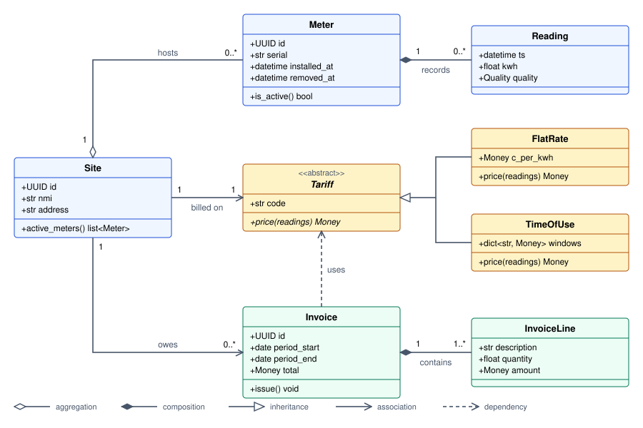
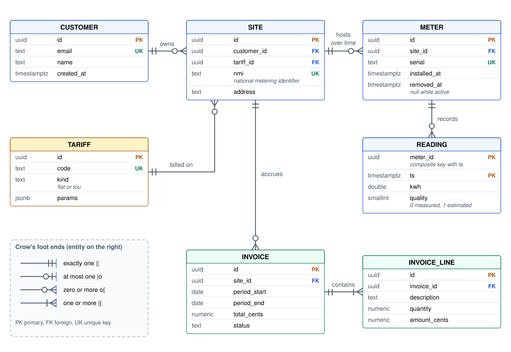
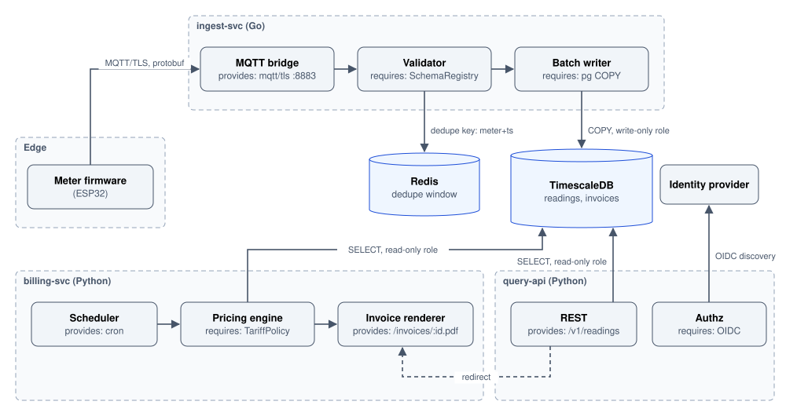
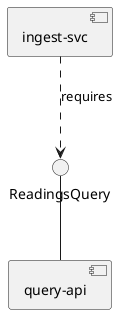
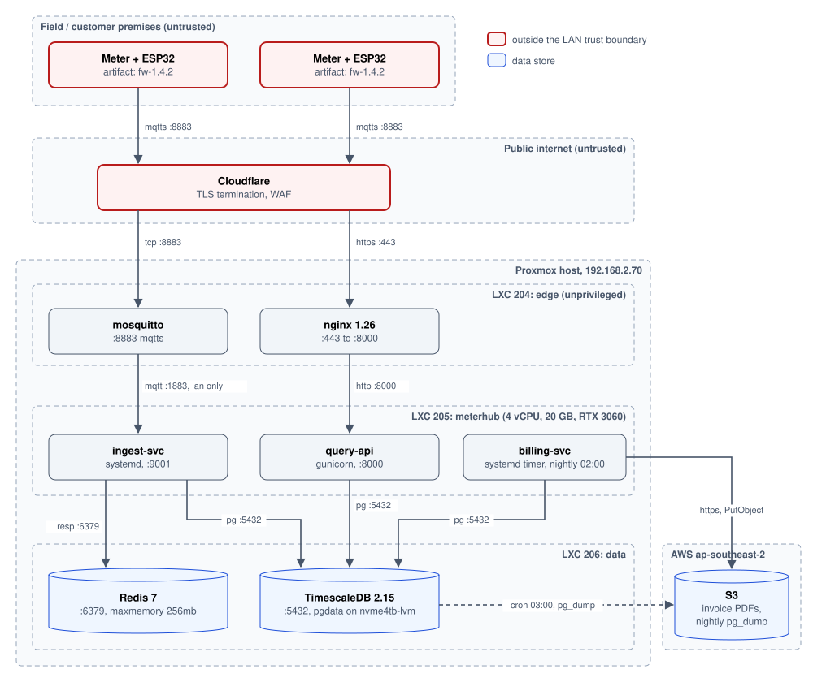
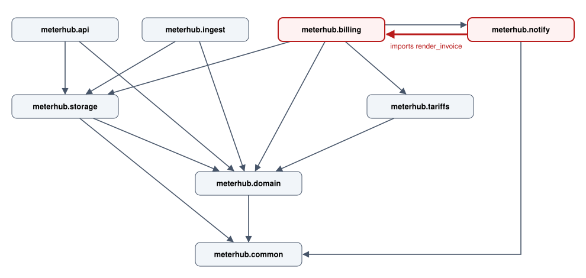

# Structural Diagrams

Class, ER, component, deployment and package diagrams: what each one is actually good for, with copy-paste Mermaid.

Author

Benedict Thekkel

## 0. What “structural” means

A structural diagram answers **“what exists and how is it wired?”**, a snapshot with time removed. If your question contains the word *when*, *then*, or *retry*, you want a [behavioural diagram](../Software_Diagrams/behavioural_diagrams.llms.md) instead.

The five that matter, ordered by value per minute of effort:

| Diagram | Answers | Lives at | Drawn by hand? |
|----|----|----|----|
| **ER** | What is the data shape? | Database | No, generate it |
| **Deployment** | What runs where? | Hosts, containers, cloud | Yes |
| **Component** | What are the moving parts and their contracts? | Services, modules | Yes |
| **Package / dependency** | What imports what, and is it a cycle? | Source tree | No, generate it |
| **Class** | What are the types and relationships? | Code | Rarely, the code says it better |

Rule of thumb: **generate the ones that describe code, hand-draw the ones that describe intent.** A generated class diagram of 200 classes is noise. A hand-drawn one of the 6 classes in your billing core is a design document. Anything hand-drawn will rot, so keep it small enough that fixing it stays worthwhile.

> **TIP:**
>
> Every diagram in this notebook describes **one running example**: *MeterHub*, a service that ingests smart-meter readings over MQTT, stores them as time series, and bills customers monthly. Same system, five lenses. Comparing the lenses is the point.

------------------------------------------------------------------------

## 1. Class diagram

**What it is:** types, their fields and methods, and the relationships between them. The most-taught and least-useful UML diagram, because the code already contains every fact in it, and the code is never out of date.

**When it earns its keep**

- Designing a domain model *before* the code exists. The diagram is cheaper to throw away than classes.
- Explaining a polymorphic seam: an interface plus its three implementations, on one page.
- Onboarding someone into a model with non-obvious cardinality. `Site` has many `Meter`s, but a `Meter` can move between `Site`s over time, and that fact is worth drawing.

**When to skip it:** documenting an existing codebase class by class. Use `pyreverse` if you must, and do not commit the output.

### Notation

| Mermaid     | Means       | Read as                                     |
|-------------|-------------|---------------------------------------------|
| `A <\|-- B` | Inheritance | B *is a* A                                  |
| `A *-- B`   | Composition | B cannot exist without A (delete A, B dies) |
| `A o-- B`   | Aggregation | A holds B, but B outlives it                |
| `A --> B`   | Association | A has a reference to B                      |
| `A ..> B`   | Dependency  | A merely uses B (parameter, local variable) |
| `A ..\|> B` | Realization | A implements interface B                    |
| `+ - # ~`   | Visibility  | public, private, protected, package         |

Multiplicity goes in quotes on the ends: `Site "1" --> "0..*" Meter`.

### Example: the MeterHub domain model



UML class diagram of the MeterHub domain model: Site aggregates Meters, Meter composes Readings, Invoice composes InvoiceLines, FlatRate and TimeOfUse inherit from the abstract Tariff, and Invoice depends on Tariff

Read what the arrowheads claim. A `Reading` is *composed* into its `Meter`, so dropping the meter drops the readings with it. A `Meter` is only *aggregated* by a `Site`, so moving the meter to another site leaves it intact. That distinction is the entire reason `removed_at` exists on `Meter`, and it is the kind of thing a diagram states in one glyph while prose takes a paragraph to fumble.

### Generating one instead

``` bash
# Python: writes classes.dot / packages.dot (pylint ships it)
pyreverse -o png -p MeterHub meterhub/

# TypeScript
npx tsuml2 --glob "./src/**/*.ts" -o classes.svg
```

> **WARNING:**
>
> Mermaid’s `classDiagram` uses `~` for generics (`list~Meter~`), not angle brackets, which collide with the HTML it renders into. A trailing asterisk (`Money*`) marks an abstract method, and a trailing `$` marks a static one.

------------------------------------------------------------------------

## 2. ER diagram

**What it is:** tables, columns, keys and the cardinality of the relationships between them. The highest value-per-effort structural diagram, because the schema is the one part of a system that is genuinely hard to read from source and genuinely expensive to get wrong.

**When it earns its keep:** almost always. Before a migration, during a design review, in the README of any service that owns a database.

### Notation: the crow’s foot, decoded

Mermaid writes a relationship as `LEFT <left-card>--<right-card> RIGHT : label`, and each cardinality is **two characters**: the inner one is the minimum, the outer one is the maximum.

| Symbol | Min  | Max  | Reads as                   |
|--------|------|------|----------------------------|
| `\|\|` | one  | one  | exactly one                |
| `\|o`  | zero | one  | at most one                |
| `}o`   | zero | many | any number, including none |
| `}\|`  | one  | many | at least one               |

So `CUSTOMER ||--o{ INVOICE` says “one customer has zero or more invoices, and every invoice has exactly one customer”. The symbol nearest a table describes *that* table’s side.

### Example: the MeterHub schema



Crow’s foot ER diagram of the MeterHub schema: CUSTOMER, SITE, METER, READING, TARIFF, INVOICE and INVOICE_LINE with their keys and cardinalities

Two things this diagram makes visible that the migration files do not:

1.  `READING` has a **composite primary key** `(meter_id, ts)` and no surrogate id, the giveaway that it is a time-series table (a Timescale hypertable) rather than a normal entity.
2.  `INVOICE ||--|{ INVOICE_LINE` uses `|{`, meaning “one or more”. An invoice with zero lines is not something the domain allows. That is a business rule, sitting in the diagram where a reviewer can argue with it.

### Generating one instead

``` bash
# Django
python manage.py graph_models -a -o erd.png          # django-extensions

# Any SQL database, straight to Mermaid
npx @liam-hq/cli erd build --format postgres --input "$DATABASE_URL"

# SQLAlchemy
eralchemy -i "postgresql://..." -o erd.pdf
```

> **TIP:**
>
> Commit the *generated* ER diagram and regenerate it in CI. It is the one diagram where staleness is both likely and immediately harmful, and the one where regeneration is free.

------------------------------------------------------------------------

## 3. Component diagram

**What it is:** the deployable or linkable parts of a system and the **interfaces** they offer and require. UML draws these as boxes with lollipop (provided) and socket (required) connectors.

**When it earns its keep:** whenever the interesting fact is the contract rather than the box. “The worker talks to the database” is not worth drawing. “The worker is the only thing holding a write connection to the readings table, and everything else goes through the query API” is worth drawing, because it is a constraint someone can violate.

**Component versus container:** if you are drawing boxes for *processes*, you are drawing a [C4 container diagram](../Software_Diagrams/architectural_diagrams.llms.md), which is usually the better tool. A component diagram lives one level down, describing the modules *inside* one deployable.

Mermaid has no UML component notation, so use a `flowchart` with subgraphs and label every edge with the protocol plus the contract. **An unlabelled arrow in a component diagram is a wasted arrow.**

### Example: MeterHub components and their contracts



Component diagram of MeterHub: ingest-svc, billing-svc and query-api modules, with only the batch writer holding a write role on TimescaleDB

The diagram earns its place on one edge: `WRT` is the **only** arrow into `DB` not labelled read-only. That is the architectural rule, and it is now checkable. If a second write arrow ever appears in this picture, someone has to justify it in review.

### Where Mermaid runs out

For true lollipop and socket notation, or for interfaces as first-class named things, use PlantUML:



Or [D2](https://d2lang.com), which handles dense many-to-many layouts far better than Mermaid does.

------------------------------------------------------------------------

## 4. Deployment diagram

**What it is:** the mapping from software artifacts to the physical or virtual things that run them: hosts, VMs, containers, availability zones, devices.

**When it earns its keep:** every time. This is the diagram people actually open at 2am. It is also the only structural diagram whose facts live nowhere in the source code. They are spread across Terraform, Ansible, compose files and a DNS console, which is exactly why one picture pays for itself.

**What must be on it:** node boundaries, what is deployed inside each, the network path between them with **ports and protocols**, and the trust boundary. What must *not* be on it: anything that is not a deployment fact. Resist adding classes.

### Example: MeterHub on a Proxmox home lab



Deployment diagram of MeterHub on a Proxmox home lab: field meters and Cloudflare outside the trust boundary in red, three LXC containers on the host, and S3 in AWS

Note what the red nodes do: they mark everything outside the LAN trust boundary. Once that line is on the page, “which hops are encrypted?” becomes a question you answer by tracing edges, and it is the seed of a [data flow diagram for threat modelling](../Software_Diagrams/architectural_diagrams.llms.md).

> **NOTE:**
>
> UML has real deployment notation: 3D `<<device>>` and `<<execution environment>>` nodes with nested artifacts. Nobody misses it. A nested-subgraph flowchart carries the same information and renders in a pull request.

------------------------------------------------------------------------

## 5. Package / dependency diagram

**What it is:** modules or packages as nodes, imports as edges. The one structural diagram whose main purpose is not communication but **detection**. You draw it to find the cycle.

**When it earns its keep:** when builds are slow, when small changes trigger wide rebuilds, when a unit test needs six unrelated imports to run, or before splitting a monolith. Layering violations are almost invisible in a file tree and glaring in a graph.

### Example: MeterHub’s Python packages, with the cycle it grew



Package dependency graph of meterhub, with a red import cycle between meterhub.billing and meterhub.notify

`billing` imports `notify`, and `notify` imports `billing` straight back. It happened the usual way: the email template needed to render an invoice, `render_invoice` lived in `billing`, and importing it was one line. The fix is also the usual one. Move the shared thing down (`render_invoice` into `domain`) or invert the dependency (pass an already-rendered blob into `notify`). Either way, the graph is what makes the argument.

### Generating one, and enforcing it

``` bash
# Python: draw it
pydeps meterhub --max-bacon 2 --cluster -o deps.svg
pyreverse -o png -p MeterHub meterhub/          # produces packages.png

# Python: fail CI on a violation
pip install import-linter                       # then define contracts in setup.cfg
lint-imports

# JS/TS
npx madge --circular --extensions ts,tsx src/
npx depcruise --validate .dependency-cruiser.js src
```

An `import-linter` contract that would have caught the cycle above:

``` ini
[importlinter]
root_package = meterhub

[importlinter:contract:layers]
name = MeterHub layers
type = layers
layers =
    meterhub.api
    meterhub.billing
    meterhub.storage
    meterhub.domain
    meterhub.common
```

> **TIP:**
>
> The diagram finds the cycle once. The linter contract stops it coming back. Draw it to convince people, then encode it so you never have to draw it again.

------------------------------------------------------------------------

## 6. Picking one, and keeping it honest

**Decision shortcut**

| The question in the room | Draw |
|----|----|
| “What columns does that live in?” | ER |
| “Where does this actually run, on which port?” | Deployment |
| “Who is allowed to call what?” | Component, with every edge labelled |
| “Why is the build slow, why can’t I test this alone?” | Package |
| “How should we model this before we build it?” | Class, then delete it once the code lands |

**Three habits that keep structural diagrams from rotting**

1.  **Store the source, not the picture.** A Mermaid block in a markdown file diffs in review. A PNG from a whiteboard does not. Every diagram in this notebook is text.
2.  **Generate whatever can be generated** (ER, package) and run it in CI. Hand-maintain only the diagrams that encode intent (component, deployment), and put them in the repo they describe rather than a wiki nobody opens.
3.  **Cap it at what fits on a screen.** Past roughly 15 nodes a structural diagram stops being read and starts being scrolled. Split by lens rather than by zoom: one deployment diagram, one component diagram, never one diagram carrying both.

> **WARNING:**
>
> The most common failure is drawing a class diagram when the question was behavioural. “Why did the invoice come out wrong?” is not answered by anything in this notebook. That is a [sequence diagram or a state machine](../Software_Diagrams/behavioural_diagrams.llms.md).

------------------------------------------------------------------------

Back to top
