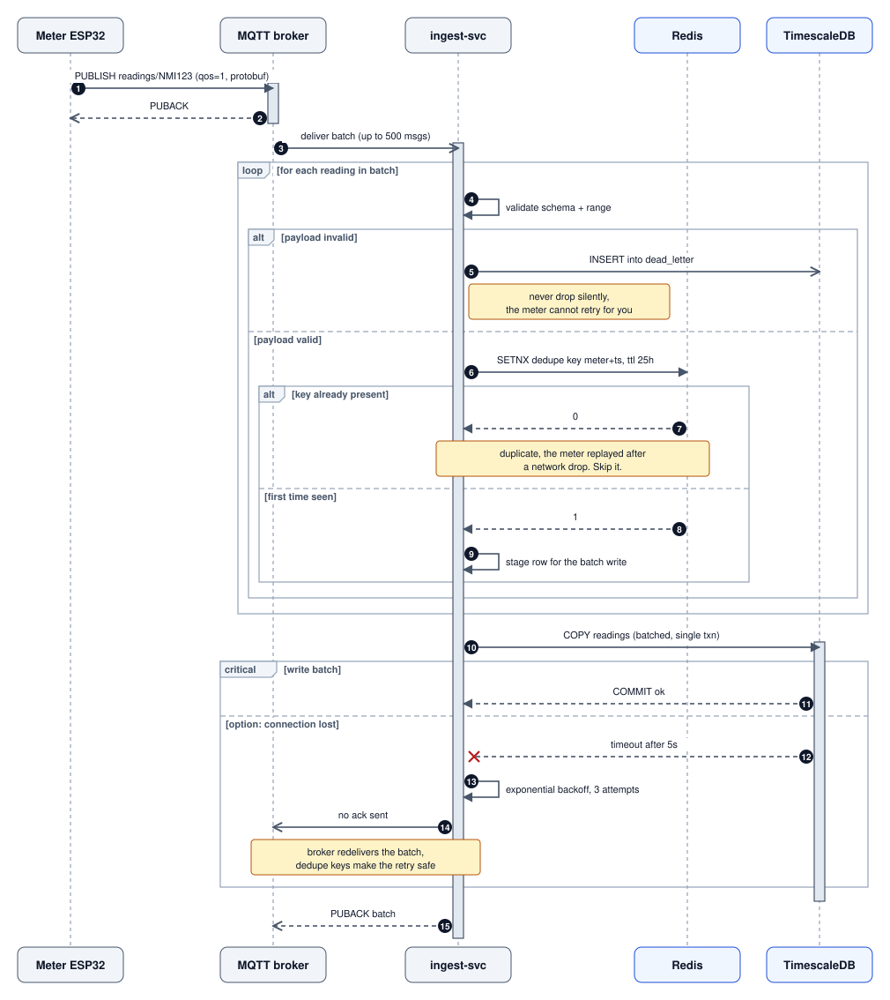
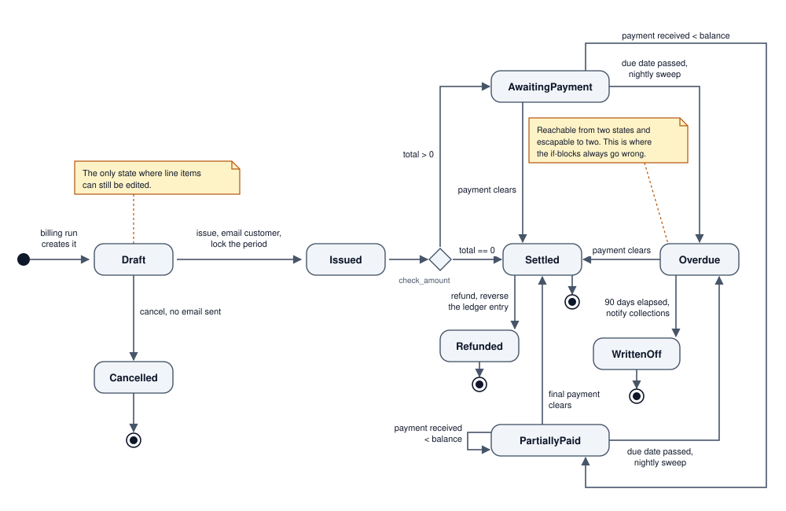
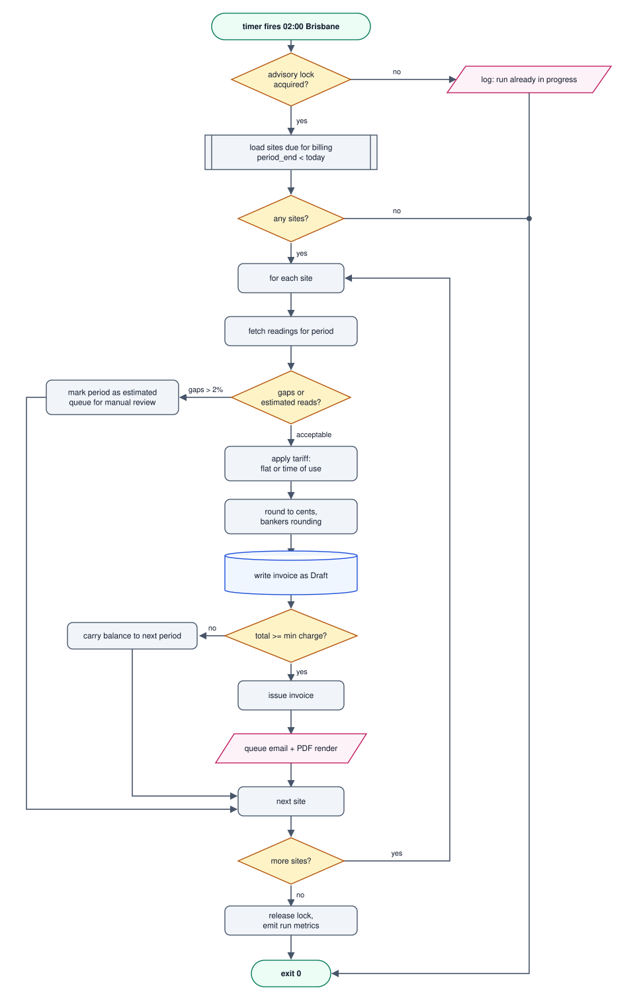
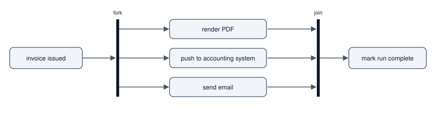

# Behavioural Diagrams

Sequence, state machine and activity diagrams: how a system behaves over time, and which one to reach for.

Author

Benedict Thekkel

## 0. What “behavioural” means

A [structural diagram](../Software_Diagrams/structural_diagrams.llms.md) freezes time and shows what exists. A behavioural diagram does the opposite: it keeps one small slice of the system and plays it forward. If the question contains *when*, *then*, *while*, *retry*, *timeout*, or *what if it fails*, this is the notebook.

| Diagram | Organising axis | Best question |
|----|----|----|
| **Sequence** | Time, down the page | “Who calls whom, in what order, and what happens when a call fails?” |
| **State machine** | The lifecycle of one entity | “What states can an order be in, and which transitions are legal?” |
| **Activity / flowchart** | Control flow of one procedure | “What are the branches and loops in this job?” |
| **Communication** | Spatial layout of the same messages | Nothing a sequence diagram does not answer better |

The three that matter are sequence, state machine and activity, and they are not interchangeable. A useful diagnostic: **count the nouns**. Many participants exchanging messages means sequence. One noun moving through a lifecycle means state machine. No nouns, just steps and decisions, means activity.

> **TIP:**
>
> This notebook continues the *MeterHub* example from [Structural Diagrams](../Software_Diagrams/structural_diagrams.llms.md): smart meters publish readings over MQTT, a service stores them as time series, and a nightly job bills customers.

------------------------------------------------------------------------

## 1. Sequence diagram

**What it is:** participants across the top, time running down, messages as arrows between the vertical lifelines. The single most useful UML diagram for real work.

**When it earns its keep:** authentication flows, webhook handling, anything involving a queue, anything involving more than two processes, and above all **anything with a failure path**. Distributed bugs are almost always ordering bugs, and this is the only notation that puts ordering on an axis.

**When to skip it:** a single-process function call chain. That is a stack trace, not a diagram.

### Notation that carries meaning

| Mermaid | Means |
|----|----|
| `A->>B: msg` | Solid arrow, a call or request |
| `A-->>B: msg` | Dashed arrow, a return or reply |
| `A-)B: msg` | Open arrowhead, asynchronous, sender does not wait |
| `A--)B: msg` | Asynchronous reply |
| `A-x B: msg` | Message lost or discarded |
| `activate` / `deactivate` | Activation bar, participant is busy |
| `alt` / `else` | Mutually exclusive branches |
| `opt` | Branch that may not happen at all |
| `loop` | Repetition, with the condition in the label |
| `par` | Genuinely concurrent branches |
| `critical` / `option` | A section with alternative failure handling |

The blocks are what separate a useful sequence diagram from a doodle. A diagram with no `alt` and no `loop` is describing the happy path only, which is the path nobody needed a diagram for.

### Example: ingesting a reading, including the paths that go wrong



Sequence diagram: a meter publishes a reading to the MQTT broker, ingest-svc validates and dedupes each reading in Redis, then batch writes to TimescaleDB, with loop, alt and critical frames and the retry path

Everything valuable in that diagram is in the `alt`, `critical` and `Note` blocks. The happy path is four arrows and needed no picture. What needed a picture is the interaction between three separate mechanisms: broker redelivery, the Redis dedupe key, and the batch transaction. **Idempotency claims are only checkable on a sequence diagram**, because idempotency is a statement about ordering.

### The two habits that make them good

1.  **Draw the failure branch or do not bother.** If you cannot say what happens when the third arrow times out, the design is not finished, and the diagram just showed you that.
2.  **Name the protocol on every arrow.** `POST /v1/readings` and “publishes readings” are different amounts of information, and one of them fits in the same space.

> **NOTE:**
>
> `autonumber` costs one word and gives every arrow a stable number, which makes the diagram citable in review comments (“step 7 is the problem”). Use it on anything longer than five messages.

------------------------------------------------------------------------

## 2. State machine diagram

**What it is:** the legal states of **one** entity and the transitions between them, each labelled with the event that causes it.

**When it earns its keep:** the moment you are about to write a large `if status ==` block, or add a fifth value to a status column. A status field with six values has up to 30 possible transitions, and your code probably permits several that the business forbids. The diagram is where you find out.

**The tell:** any table with a `status`, `state`, `phase` or `stage` column deserves one of these, committed next to the model.

### Notation

| Mermaid | Means |
|----|----|
| `[*] --> A` | Initial state, where the entity is born |
| `A --> [*]` | Terminal state |
| `A --> B : event / action` | Transition, fired by an event, optionally doing something |
| `state X <<choice>>` | A branch on a guard condition |
| `state X <<fork>>` / `<<join>>` | Split into and rejoin from concurrent regions |
| `state A { ... }` | Composite state, a machine nested inside a state |

### Example: the invoice lifecycle



State machine for the invoice lifecycle: Draft, Issued, a choice on the total, AwaitingPayment, PartiallyPaid, Overdue, Settled, WrittenOff, Refunded and Cancelled

The diagram argues for three things at once that prose would have buried. Editing is legal only in `Draft`, so the write path needs exactly one guard. There is no arrow from `Settled` back to `AwaitingPayment`, so a late partial refund is a `Refunded` transition rather than a reopened invoice. And `Overdue` is a hub, so it is the state that deserves the tests.

### Turning the picture into code

A state machine on a whiteboard is a suggestion. The same machine as a transition table is enforcement:

``` python
from enum import StrEnum

class Invoice(StrEnum):
    DRAFT = "draft"
    ISSUED = "issued"
    AWAITING = "awaiting_payment"
    PARTIAL = "partially_paid"
    OVERDUE = "overdue"
    SETTLED = "settled"
    WRITTEN_OFF = "written_off"
    REFUNDED = "refunded"
    CANCELLED = "cancelled"

# The diagram above, verbatim. Anything not listed is illegal.
ALLOWED: dict[Invoice, set[Invoice]] = {
    Invoice.DRAFT:    {Invoice.ISSUED, Invoice.CANCELLED},
    Invoice.ISSUED:   {Invoice.AWAITING, Invoice.SETTLED},
    Invoice.AWAITING: {Invoice.PARTIAL, Invoice.SETTLED, Invoice.OVERDUE},
    Invoice.PARTIAL:  {Invoice.PARTIAL, Invoice.SETTLED, Invoice.OVERDUE},
    Invoice.OVERDUE:  {Invoice.SETTLED, Invoice.WRITTEN_OFF},
    Invoice.SETTLED:  {Invoice.REFUNDED},
    Invoice.WRITTEN_OFF: set(),
    Invoice.REFUNDED: set(),
    Invoice.CANCELLED: set(),
}

def transition(current: Invoice, target: Invoice) -> Invoice:
    if target not in ALLOWED[current]:
        raise ValueError(f"illegal transition {current} -> {target}")
    return target
```

Libraries that do this for you: `transitions` and `python-statemachine` in Python, `XState` in TypeScript, `AASM` in Ruby. All of them can emit the diagram from the definition, which is the ideal arrangement: one source, both artifacts.

> **WARNING:**
>
> Two states that always change together belong in one composite state or one machine. Two `status` columns on the same table that are edited by different code paths is a bug waiting to happen, and it shows up on the diagram as two disconnected machines fighting over one row.

------------------------------------------------------------------------

## 3. Activity diagram (flowchart)

**What it is:** the control flow of a single procedure: steps, decisions, loops, and where work happens in parallel. UML calls it an activity diagram, everyone else calls it a flowchart, and Mermaid’s `flowchart` renders it.

**When it earns its keep:** a business process with real branching (eligibility rules, refund approval, a CI pipeline), or a batch job whose failure modes matter. Also the fastest way to review a policy with someone who does not read code.

**When to skip it:** straight-line code. A flowchart of five sequential steps is a bulleted list that took longer to draw.

**Swimlanes:** if the branches are owned by *different people or systems*, add lanes. Mermaid does that with subgraphs, and the technique gets its own treatment in [Process and Ops Diagrams](../Software_Diagrams/process_ops_diagrams.llms.md).

### Example: the nightly billing run



Activity flowchart of the nightly billing run: lock check, load sites, per site pricing with a manual review branch for gaps, invoice draft and issue, then release the lock

Shapes are doing work here, and they are worth using consistently: `([...])` stadium for start and end, `{...}` diamond for a decision, `[[...]]` subroutine for a call out to something else, `[(...)]` cylinder for a database write, `[/.../]` parallelogram for input and output. Pick a vocabulary once and keep it across every diagram in the repo, otherwise the shapes are decoration.

The decision worth arguing about is visible immediately: `gaps > 2%` sends the whole period to manual review, and there is no path from `FLAG` back into pricing. That is a deliberate choice, drawn where a reviewer can challenge it.

### Parallel work

When branches genuinely run at once, say so rather than implying an order:



Fork and join: after the invoice is issued, render PDF, push to accounting system and send email run concurrently, then the run is marked complete

The black bars are UML fork and join bars. Everything between them happens concurrently, and the run is not complete until all three finish.

------------------------------------------------------------------------

## 4. Communication diagram, and why to skip it

A communication diagram (called a collaboration diagram before UML 2) shows the same messages as a sequence diagram, but arranged spatially with the ordering carried by numbered labels such as `1.1`, `1.2`, `2.1`.

It contains exactly the same information. The only thing it does better is emphasise *which participants talk to each other at all* rather than *in what order*, and if that is your question you want a [component diagram](../Software_Diagrams/structural_diagrams.llms.md) or a [C4 container diagram](../Software_Diagrams/architectural_diagrams.llms.md). Reading order from decimal numbering is strictly worse than reading it from a vertical axis.

Mermaid has no communication-diagram syntax, which is a reasonable verdict in itself.

------------------------------------------------------------------------

## 5. Choosing, and the failure modes

**Decision shortcut**

| The question in the room | Draw |
|----|----|
| “Why did the retry double-charge them?” | Sequence, with the `alt` and `critical` blocks filled in |
| “Can an invoice go from settled back to overdue?” | State machine |
| “What exactly does the nightly job do?” | Activity |
| “Which service talks to which?” | Not behavioural. C4 container or component |
| “Who is responsible for this step?” | Swimlane, see [Process and Ops](../Software_Diagrams/process_ops_diagrams.llms.md) |

**The four ways these go wrong**

1.  **Happy path only.** The most common failure by a distance. A sequence diagram without a failure branch, or a state machine without its terminal and error states, is a marketing diagram.
2.  **Mixing the lenses.** Participants *and* decision diamonds *and* lifecycle states in one picture produces something nobody can read. One question per diagram.
3.  **Too many participants.** Past about seven lifelines a sequence diagram becomes a wiring harness. Collapse the ones that are not the subject into a single participant labelled with what it does.
4.  **Drawing the code.** If the diagram has one box per function, it is a slow, stale reimplementation of the call graph. Draw the interaction between processes instead, since that is what no tool can recover for you.

> **TIP:**
>
> Keep behavioural diagrams next to the thing they describe: the sequence diagram in the service README, the state machine in the docstring of the model it governs. A diagram that lives in a wiki describes a system that used to exist.

------------------------------------------------------------------------

Back to top
