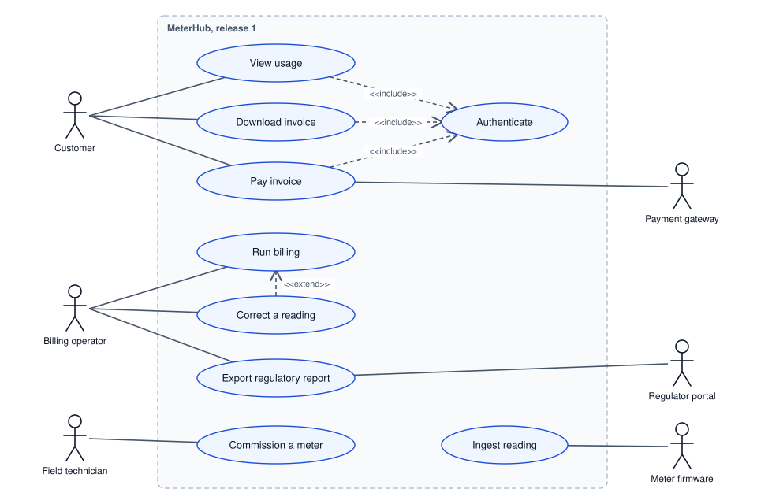
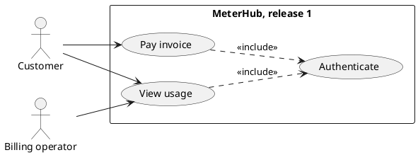
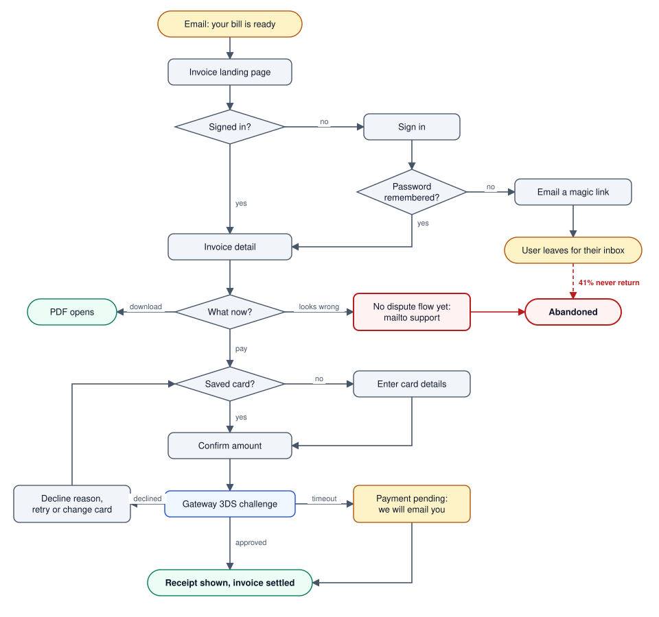
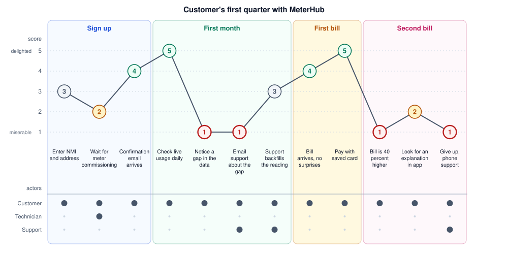
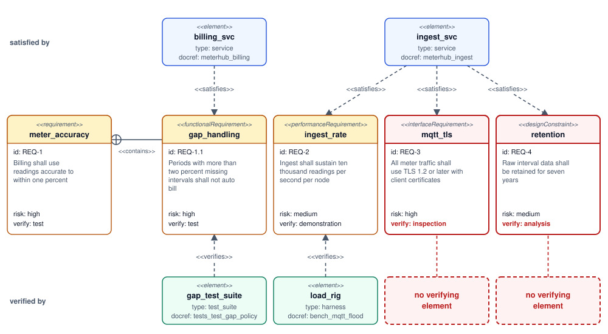

# Requirements and Scope Diagrams

Use case diagrams, user flows, journey maps and requirement traceability: drawing what the system is for, and where it stops.

Author

Benedict Thekkel

## 0. What these are for

[Structural](../Software_Diagrams/structural_diagrams.llms.md) and [behavioural](../Software_Diagrams/behavioural_diagrams.llms.md) diagrams describe a system that exists. The diagrams here describe one that does not exist yet, and their real job is **agreeing on the boundary before anyone writes code**.

That makes them the most political diagrams in the set. Nobody argues about which port Postgres listens on. Everybody argues about whether bill disputes are in scope for version one. A scope diagram is useful precisely to the extent that it makes such an argument happen early and in one room.

| Diagram | Audience | Answers |
|----|----|----|
| **Use case** | Analysts, stakeholders | Who are the actors, and what is inside the boundary? |
| **User flow** | Product, design, engineering | What screens and decisions does a person move through? |
| **Journey map** | Product, leadership | Where in the experience is the pain? |
| **Requirement diagram** | Regulated or safety-critical work | Which requirement does this component satisfy, and how is it verified? |

> **WARNING:**
>
> These are the diagram types most often produced as ceremony: drawn once for a document, approved, and never opened again. Each section below states what the diagram has to contain to avoid that fate. If yours cannot meet that bar, write a bulleted list of scope and non-scope instead. Nobody will mind.

The running example continues: *MeterHub*, a service that ingests smart-meter readings and bills customers monthly.

------------------------------------------------------------------------

## 1. Use case diagram

**What it is:** actors (people or external systems) outside a boundary box, use cases (verb phrases) inside it, and lines between them. Plus two relationships worth knowing: `<<include>>` for a step that always happens as part of another, and `<<extend>>` for a conditional variation.

**The honest assessment:** as a description of behaviour it is nearly worthless, because “Pay invoice” in an oval tells you nothing that the phrase alone did not. It has exactly two genuine uses:

1.  **The boundary.** The box is the system. Everything outside it is somebody else’s problem, and drawing the box forces that conversation.
2.  **The actor inventory.** Actors include non-humans, and the external systems are what people forget to budget for. The payment gateway, the regulator’s reporting portal and the meter firmware are all integration work that nobody scoped because they were not in the user stories.

**What makes it non-ceremonial:** an explicit **out of scope** list on the same page. A use case diagram without one is a wish list.

Mermaid has no use case notation, so this one is drawn in UML:

Use case diagram: Customer, Billing operator and Field technician on the left, Payment gateway, Regulator portal and Meter firmware on the right, nine use cases inside the MeterHub release 1 boundary, three include arrows to Authenticate and one extend arrow from Correct a reading to Run billing

**Explicitly out of scope for release 1:** dispute workflow, tariff self-service switching, prepayment meters, anything to do with solar export credits.

That last line is the part with value. The diagram gets three actors onto the page that a requirements document written from customer interviews would have missed entirely, since the payment gateway, the regulator portal and the meter firmware do not attend interviews.

### PlantUML, if you want the real notation

------------------------------------------------------------------------

## 2. User flow

**What it is:** the path a person takes through screens and decisions to finish one task. Not UML, which is why it survived: product and design actually use these.

**When it earns its keep:** any flow with branching where the branches are *states of the user*, not states of the code. Signup, checkout, onboarding, password reset, and every flow that can dead-end.

**What separates it from an [activity diagram](../Software_Diagrams/behavioural_diagrams.llms.md):** the nodes are things the user sees, and the edges are things the user does. If a node is “validate token”, it belongs in an activity diagram instead.

**What makes it non-ceremonial:** every dead end is drawn, and every dead end has an exit. The value of a user flow is almost entirely in the unhappy branches, because that is where people abandon.

User flow for paying a bill, from the email through sign in, invoice detail and payment, with the magic link path losing 41% of users and the looks wrong branch ending at Abandoned

Two things fall out of drawing it. The magic-link path hands the user to their email client and 41% of them never come back, which is a measured number sitting on an edge where it can drive a decision. And “looks wrong” has no product behind it, so it exits to a mailto link. That was in the out-of-scope list in section 1, and here is what it costs.

> **TIP:**
>
> Put real numbers on the edges once you have them. A user flow annotated with drop-off rates stops being a design artifact and becomes an analytics dashboard with a memory.

------------------------------------------------------------------------

## 3. Journey map

**What it is:** stages of an experience along the horizontal, with a satisfaction score and the actor at each step. It deliberately says nothing about implementation. Its whole purpose is to make the emotional low points visible next to each other.

**When it earns its keep:** prioritisation conversations. A journey map is the cheapest way to show a room that the worst moment in the product is not the feature they were about to fund.

Mermaid has first-class support. Scores run 1 (miserable) to 5 (delighted), and the names after the score are the actors involved:

Journey map score track across four sections, with troughs at score 1 for the data gap and for the 40 percent higher bill, and actors marked under each step

The shape of that map is the argument. Signup is fine, the live usage view is loved, and both troughs are the same thing wearing different clothes: **when the number is surprising, the product has no answer**. A data gap and a bill jump both end with the customer phoning a human. That points at one feature (explain the number in the app) instead of two, and no engineering diagram would have shown it.

> **NOTE:**
>
> A journey map is only honest if the scores come from users rather than from the team’s guesses. Run it off support tickets, session recordings or five interviews. An invented journey map is a mirror.

------------------------------------------------------------------------

## 4. Requirement diagram

**What it is:** SysML’s traceability notation. Requirements as boxes carrying an id, a risk level and a **verification method**, linked to each other and to the elements that satisfy or verify them.

**When it earns its keep:** regulated, safety-critical, contractual or certification work, where the question “prove this requirement is met” gets asked by an auditor. In ordinary product work an issue tracker does this better.

**What makes it non-ceremonial:** every requirement has a `verifymethod` that names a real artifact. “Inspection” that means “someone looked at it once” is how traceability matrices become fiction.

Requirement diagram: five requirements with id, text, risk and verification method, satisfied by billing_svc and ingest_svc, verified by gap_test_suite and load_rig, with mqtt_tls and retention having no verifying element

Read it as a gap finder rather than a picture. `mqtt_tls` and `retention` are both satisfied by a service and verified by nothing, and `retention` is a seven-year promise checked by “analysis”. Those two holes are the entire reason to draw the diagram, and they take about four seconds to spot here against an afternoon in a spreadsheet.

**Relationship vocabulary:** `contains`, `derives`, `satisfies`, `verifies`, `refines`, `traces`, `copies`. **Requirement types:** `requirement`, `functionalRequirement`, `performanceRequirement`, `interfaceRequirement`, `physicalRequirement`, `designConstraint`.

> **WARNING:**
>
> Quote any `id` that is not a bare word or number. `id: REQ-1` is a parse error, because the hyphen ends the token and Mermaid then finds text where it wanted a newline. `id: "REQ-1"` renders. The same applies to `docref`, so keep paths out of it or quote them.

------------------------------------------------------------------------

## 5. Choosing, and the ceremony test

**Decision shortcut**

| The question in the room | Draw | Skip it if |
|----|----|----|
| “Is that in version one?” | Use case, with an out-of-scope list | You can write the list without the ovals, which is usually |
| “Where do people give up?” | User flow with drop-off numbers | Every branch is happy path |
| “What should we build next?” | Journey map from real research | The scores are guesses |
| “How do we prove we meet this?” | Requirement diagram | No auditor is coming, use the issue tracker |

**The ceremony test.** Before drawing any diagram in this notebook, answer one question: *what decision changes depending on what this shows?* If the answer is “none, it goes in the document”, do not draw it. Scope diagrams are the ones most likely to be produced because a template has a slot for them, and a template is not a decision.

**Three things worth more than any of these diagrams**

1.  **A written non-scope list.** Two columns, in scope and out of scope, dated and agreed. It takes ten minutes and settles more arguments than every use case oval ever drawn.
2.  **Acceptance criteria in the tracker.** Given, when, then, attached to the work item, executable where possible. Traceability that lives where the work lives.
3.  **A prototype.** For anything user-facing, a clickable prototype outruns a user flow diagram, because people react to what they can touch and merely nod at what they can read.

Once the boundary is agreed, the next question is how the thing is built. That is [Architectural Diagrams](../Software_Diagrams/architectural_diagrams.llms.md).

------------------------------------------------------------------------

Back to top
