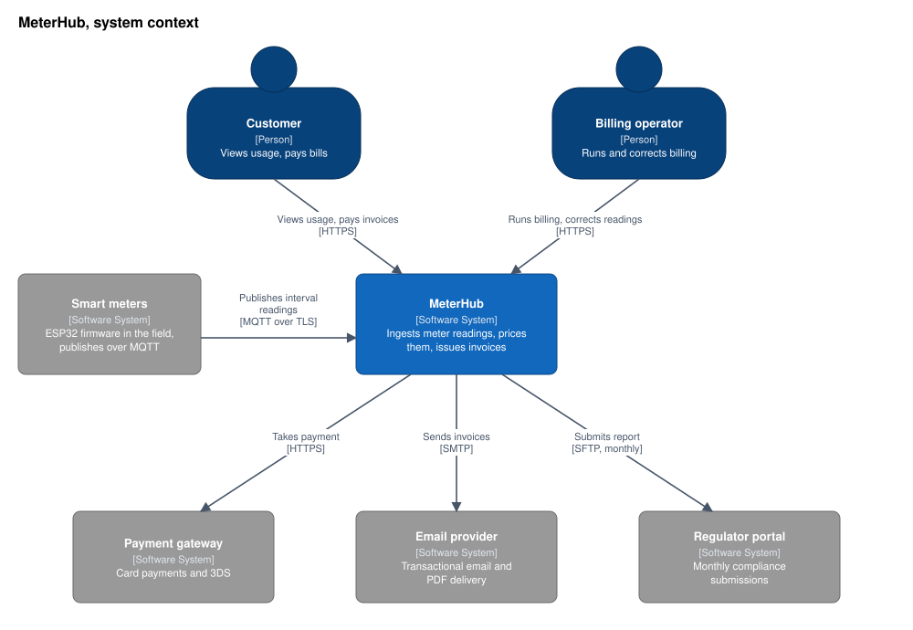
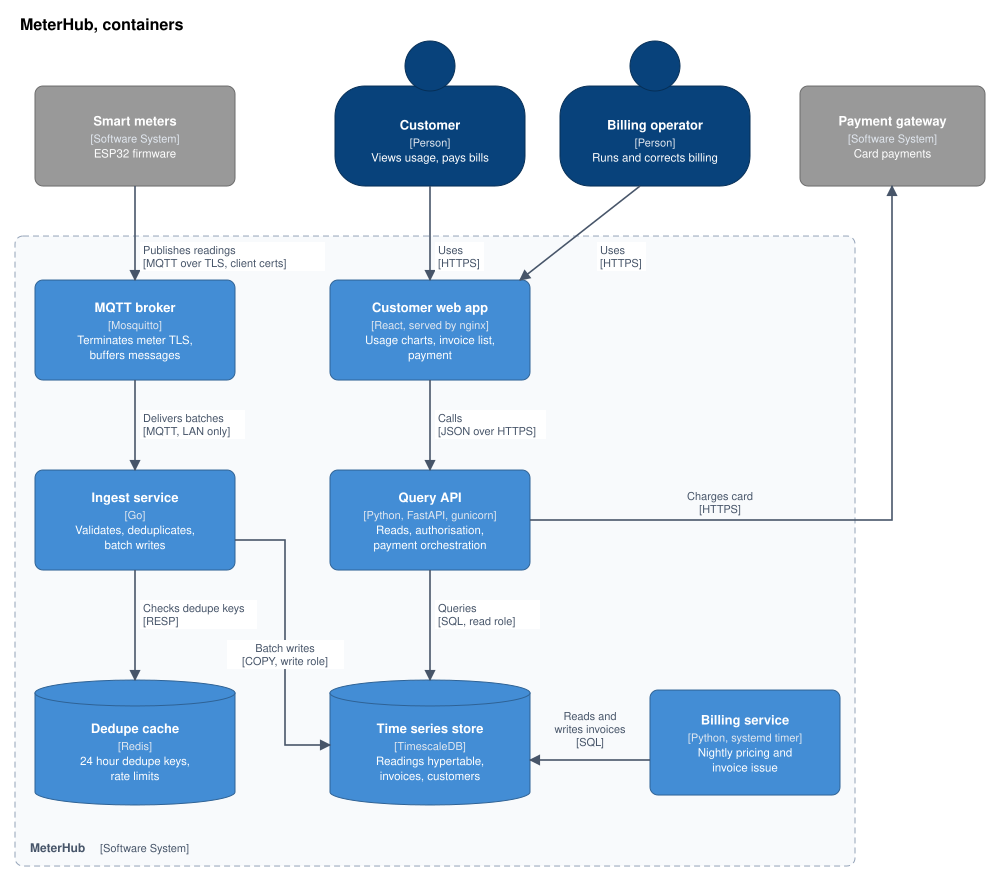
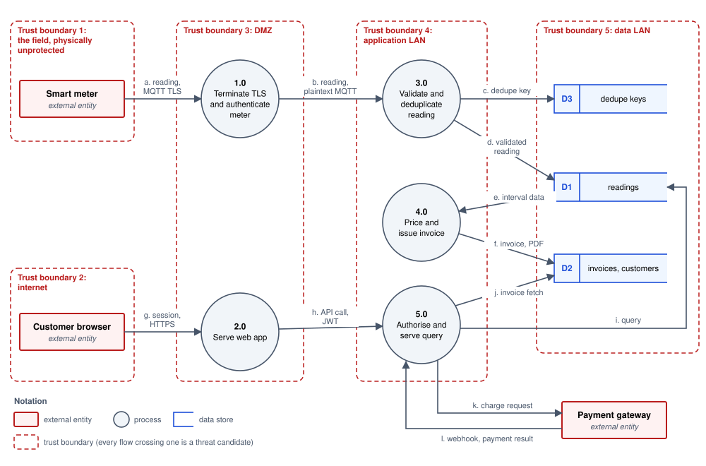
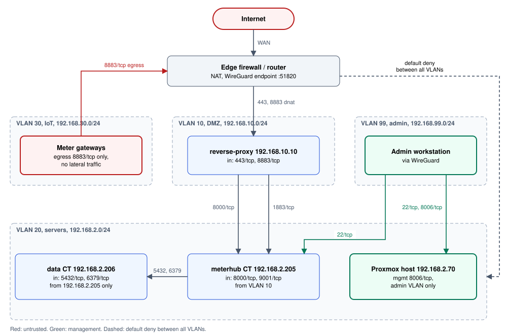

# Architectural Diagrams

C4, data flow diagrams and network topology: the non-UML notations that most architecture questions actually want.

Author

Benedict Thekkel

## 0. Why the non-UML ones won

UML has notation for architecture. Almost nobody uses it, and the reason is not fashion: UML’s architecture diagrams have no concept of **zoom level**. Every box is a box, so one diagram ends up carrying a load balancer, a Python module and a domain class, and it becomes unreadable at exactly the moment it becomes important.

The notations here each fix that by picking one axis and staying on it.

| Notation | Axis | The question it owns |
|----|----|----|
| **C4** | Level of abstraction | “What are the moving pieces, at the zoom level you asked about?” |
| **Data flow diagram** | Where data goes and which boundaries it crosses | “What could an attacker do here?” |
| **Network topology** | Addresses, segments, firewall zones | “Can this host actually reach that one?” |

Same running example as the rest of the folder: *MeterHub*, a service that ingests smart-meter readings over MQTT and bills customers monthly.

------------------------------------------------------------------------

## 1. C4: the four levels

Simon Brown’s C4 model is the pragmatic replacement for most UML architecture diagrams. Its entire contribution is insisting that **one diagram holds one zoom level**:

| Level | Boxes are | Audience | Redraw when |
|----|----|----|----|
| **1. Context** | Your system, its users, the systems it talks to | Anyone, including non-technical | A new external integration appears |
| **2. Container** | Separately deployable or runnable things: apps, services, databases, queues | Engineers, ops | A service or datastore is added |
| **3. Component** | Major building blocks inside one container | Engineers on that container | Rarely, and only for a container worth explaining |
| **4. Code** | Classes | Almost nobody | Never, generate it if you truly need it |

**The practical advice is level 1 and level 2, and stop.** A context diagram and a container diagram cover nearly every architecture conversation that happens in real teams. Level 3 is worth drawing for the one or two containers with non-obvious internals (see the [component diagram](../Software_Diagrams/structural_diagrams.llms.md) section). Level 4 is a waste of an afternoon.

### Level 1: system context

The rule is that your entire system is **one box**. Resist splitting it. The audience for this diagram is the person who does not know what the system does.



C4 system context diagram: Customer and Billing operator use MeterHub; smart meters publish readings to it; it calls the payment gateway, email provider and regulator portal

Every arrow leaving that box is an integration someone has to build, monitor and page for. That is the whole value of level 1: it makes the real surface area countable.

### Level 2: containers

Now open the box. Each container is something that runs on its own and could, in principle, be restarted independently. Technology choice goes in the second field, and it belongs there: “queue” is not a decision, “Mosquitto” is.



C4 container diagram of MeterHub: web app, query API, MQTT broker, ingest service, billing service, TimescaleDB and Redis, with the relationships and protocols between them

> **WARNING:**
>
> Mermaid’s C4 support is officially experimental and its auto-layout is the weakest part of it. For a diagram you will show to other people, either accept the layout, hand it to [Structurizr](https://structurizr.com) (C4’s reference tool, which also renders from a text DSL), or draw the same content as a plain `flowchart` with subgraphs, which is what the [deployment diagram in notebook 02](../Software_Diagrams/structural_diagrams.llms.md) does. The C4 *thinking* matters far more than the C4 *renderer*.

### Container versus deployment

These two get confused constantly. A container diagram says **what the pieces are**. A [deployment diagram](../Software_Diagrams/structural_diagrams.llms.md) says **where those pieces run**. One container can be deployed to three hosts, and one host can run five containers, so neither diagram implies the other. Draw both, keep them separate, and cross-reference them.

------------------------------------------------------------------------

## 2. Data flow diagram, and the threat model on top of it

**What it is:** processes, data stores, external entities and the data moving between them, with **trust boundaries** drawn as lines that flows cross. Notation predates UML and outlived it, because it is the foundation of STRIDE threat modelling.

**When it earns its keep:** any security review, any system handling money or personal data, and any compliance conversation. It is also the cheapest security exercise that exists: an hour with a DFD finds more than a week of scanner output.

**The one rule:** a DFD without trust boundaries is just a worse architecture diagram. The boundaries are the entire point, because every threat lives on a flow that crosses one.



Data flow diagram with five trust boundaries, processes 1.0 to 5.0, data stores D1 to D3 and flows a to l

### STRIDE, applied to the flows above

STRIDE assigns candidate threats by element type. Processes can suffer all six. Data stores mostly suffer tampering, information disclosure, repudiation and denial of service. Data flows suffer tampering, disclosure and denial of service. External entities suffer spoofing and repudiation.

| Flow or element | Threat (STRIDE) | Concrete version | Mitigation |
|----|----|----|----|
| `a` meter to DMZ | **S**poofing | Anyone can publish readings claiming to be NMI123 | Per-meter client certificates, broker ACL scoped to the meter’s own topic |
| `b` DMZ to app LAN | **T**ampering, **I**nfo disclosure | Plaintext MQTT inside the LAN, readable by anything on that segment | mTLS internally, or accept it and document the segment as trusted |
| `d`, `D1` | **T**ampering | An altered reading changes a bill and nobody can tell | Append-only readings table, corrections as new rows with a reason code |
| `e` to `4.0` | **R**epudiation | Customer disputes a bill, no record of which readings priced it | Store the reading ids and tariff version on every invoice line |
| `5.0` query | **E**levation of privilege | Customer A reads customer B’s usage by changing an id | Authorisation on every row, tested, not just on the route |
| `l` webhook | **S**poofing | Forged payment success marks an invoice settled | Verify gateway signature, confirm against the gateway API before settling |
| `1.0` broker | **D**enial of service | One misconfigured meter floods the broker | Per-client rate limits, queue depth alarms |
| `D3` dedupe cache | **D**enial of service | Cache eviction lets duplicate readings through | 25 hour TTL sized above the retry window, monitor eviction count |

Notice how mechanical that is. Walk each flow, ask the six questions, write down the ones that are not already handled. The diagram exists so the walk is exhaustive rather than a memory test.

> **TIP:**
>
> Number the processes (`1.0`, `2.0`) and letter the flows (`a`, `b`). The numbering is what lets a threat table, a code review comment and a penetration test report all point at the same thing.

------------------------------------------------------------------------

## 3. Network topology diagram

**What it is:** subnets, VLANs, firewall zones, addresses and the physical or virtual links between them. The most literal diagram in the set, and the one that ages best, since IP addresses either are or are not correct.

**When it earns its keep:** connectivity debugging, firewall change reviews, onboarding anyone who will be paged, and any audit. It is the answer to “can this host reach that one”, which is a question no amount of application-level architecture can settle.

**What must be on it:** addresses or CIDR ranges, VLAN identifiers, the direction and port of each allowed flow, and where the default deny sits. A topology diagram without ports is a wiring picture.



Network topology: Internet and edge firewall above VLAN 10 DMZ, VLAN 30 IoT and VLAN 99 admin, with VLAN 20 servers below and default deny between all VLANs

The rule this diagram encodes: **IoT gets egress only**. Meters can reach the broker port and nothing else, so a compromised meter cannot scan the server VLAN. That is one line on a firewall and one edge on a picture, and without the picture nobody notices when it is removed.

> **NOTE:**
>
> Keep the topology diagram next to the infrastructure code that creates it (Terraform, Ansible), not in a network binder. When the two disagree, the code is right and the diagram is a bug report.

------------------------------------------------------------------------

## 4. Architecture description is more than diagrams

Diagrams answer *what*. They are poor at *why*, and *why* is what the next engineer needs.

**Architecture Decision Records.** One short markdown file per decision, numbered, immutable once accepted, superseded rather than edited:

``` markdown
# ADR-014: TimescaleDB for interval data

## Status
Accepted, 2026-03-11. Supersedes ADR-009.

## Context
Readings arrive at roughly 8k rows per second and are queried as ranges per meter.
Plain Postgres held up in load tests until about the six month mark, when index
bloat on the readings table pushed p99 range queries past two seconds.

## Decision
Use TimescaleDB hypertables partitioned by week, with continuous aggregates for
the hourly and daily rollups the customer charts read.

## Consequences
Positive: range queries stay under 100ms at eighteen months of data, and
compression cuts storage by about 90 percent.
Negative: the extension pins our Postgres upgrade path, and managed hosting
options narrow considerably. Revisit if we move off self-hosting.
```

Pair the ADRs with a C4 container diagram and you have covered what most teams need. If you want a fuller template, [arc42](https://arc42.org) is the usual choice, and the 4+1 view model is the older idea it descends from: logical, process, development, physical views, plus scenarios that tie them together.

**A practical minimum for a service repository**

1.  A **context diagram** in the README, so a newcomer sees the boundary in ten seconds.
2.  A **container diagram** in the README, kept current, since it changes only a few times a year.
3.  A **deployment diagram** wherever the runbook lives.
4.  **ADRs** in `docs/adr/`, numbered, never rewritten.
5.  A **DFD with trust boundaries** if the system touches money or personal data.

Everything else is drawn on demand, for one conversation, and thrown away afterwards. That is a legitimate use of a diagram, and arguably the most common good one.

------------------------------------------------------------------------

Back to top
