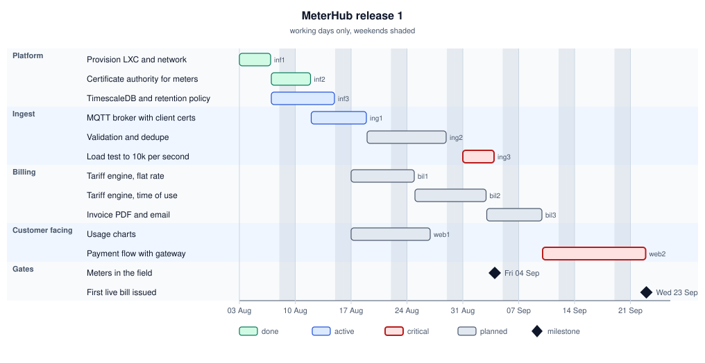
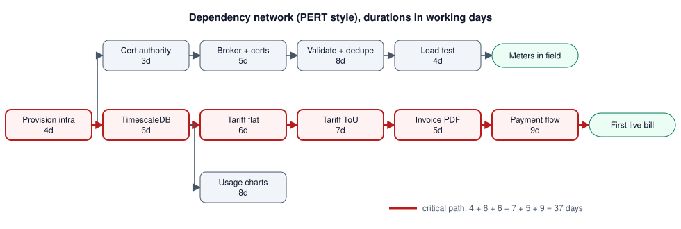
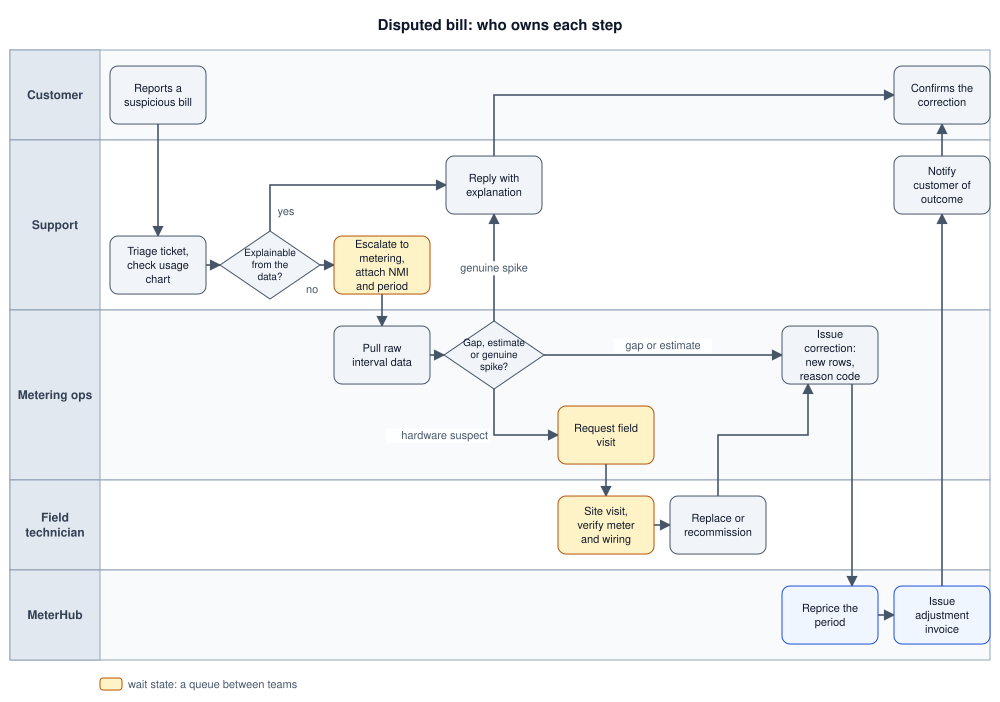
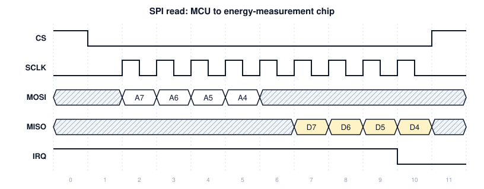
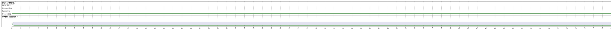
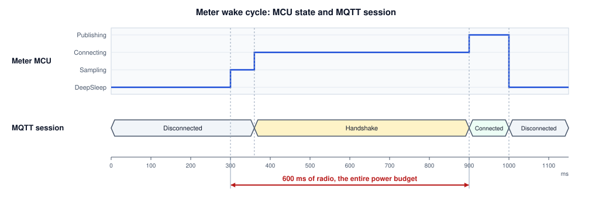
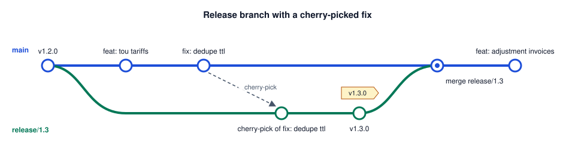
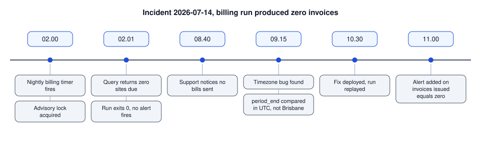
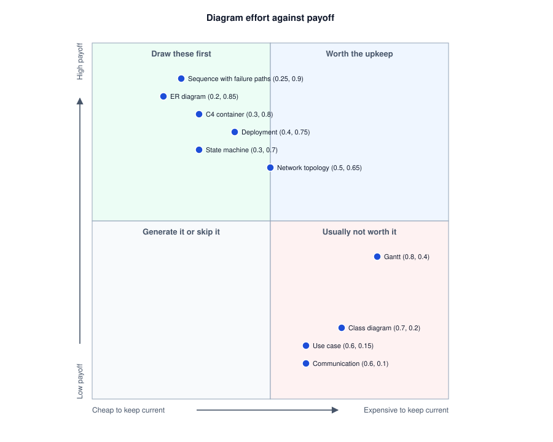

# Process and Ops Diagrams

Gantt charts, swimlanes and timing diagrams: scheduling work, assigning responsibility, and reading signals on a wire.

Author

Benedict Thekkel

## 0. What these have in common

The diagrams in notebooks 02 to 05 describe a system. These three describe **work and time**: when things happen, who owns them, and how long they take.

| Diagram | Time scale | The question it owns |
|----|----|----|
| **Gantt / dependency chart** | Weeks to months | “What blocks what, and when does this land?” |
| **Swimlane** | Hours to days | “Whose job is this step, and where does it get stuck?” |
| **Timing diagram** | Microseconds to seconds | “What is the signal actually doing, and does it meet timing?” |

Still the same running example: *MeterHub*, a service that ingests smart-meter readings over MQTT and bills customers monthly.

------------------------------------------------------------------------

## 1. Gantt and dependency charts

**What it is:** tasks as horizontal bars on a calendar, with dependencies between them and milestones as points.

**When it earns its keep:** when the interesting fact is a **dependency**, not a date. “Meter commissioning cannot start until the certificate authority exists” is worth a chart. A list of tasks with dates is a spreadsheet, and Gantt charts drawn as decorated spreadsheets are why the format has the reputation it has.

**What makes it honest:** the critical path is visible, milestones are events rather than tasks, and dates that are guesses are marked as guesses.



Gantt chart of MeterHub release 1 from 3 Aug to 23 Sep 2026, five sections, critical tasks in red and two milestones

Read the chart for its shape rather than its dates. Everything downstream of `inf3` (the database) is blocked by one task, so slipping it slips billing and the customer app together. And the two `crit` tasks, load testing and the payment flow, are the ones with external dependencies (a load rig, a gateway’s sandbox), which is exactly where estimates fail.

### Task syntax

`Task name :tag, id, start, duration` where the tags are `done`, `active`, `crit`, `milestone`, and the start can be a date or `after <id>`. `excludes weekends` keeps the arithmetic believable, and `section` groups rows.

### When the dependency matters more than the calendar

Drop the dates and draw the network. This is a PERT-style dependency chart, and the numbers on the nodes are durations:



PERT dependency network with durations, the 37 day critical path from infra to payment flow drawn in red

The red edges are the critical path: infra, database, flat tariff, time of use, PDF, payment, at 37 days. Nothing on the ingest branch can delay the launch until it exceeds that, which tells you where a second pair of hands is worth having and where it is not.

> **WARNING:**
>
> A Gantt chart is a plan, and plans are wrong. Regenerate it from the tracker rather than maintaining it by hand, or accept that it is a snapshot with a date on it. The failure mode is a beautiful chart that nobody has updated in six weeks and everybody still quotes.

------------------------------------------------------------------------

## 2. Swimlane diagram

**What it is:** a flowchart split into lanes, one per role, team or system. The steps are the same as any [activity diagram](../Software_Diagrams/behavioural_diagrams.llms.md). The lanes add the one fact that matters most in a cross-team process: **who owns this step**.

**When it earns its keep:** any process where the handoffs are the problem, which is most of them. Incident response, onboarding, procurement, refunds, deployment approvals. The lanes make queueing visible, and queueing between teams is where days disappear.

**What to look for once it is drawn:** every arrow that crosses a lane boundary is a handoff, and every handoff is a wait state. Count them. A process with nine lane crossings is not slow because people are slow.



Swimlane of a disputed bill across customer, support, metering ops, field technician and MeterHub lanes, with the three wait steps in amber

Six lane crossings on the unhappy path, and the three highlighted steps are the queues: escalation to metering, requesting a field visit, and the visit itself. The field visit is measured in days while everything else is measured in minutes, so the only optimisation that matters is **not needing the visit**, which means better remote diagnostics on the meter. Reading that off the diagram takes ten seconds. Arguing about it without a diagram takes a meeting.

> **NOTE:**
>
> Mermaid has no true swimlane primitive. Subgraphs plus `flowchart TB` get you horizontal lanes, and `flowchart LR` gets you vertical ones, but the layout engine will not keep lanes tidy in complicated processes. For a large process, [BPMN](https://www.bpmn.org) (drawn in bpmn.io or Camunda Modeler) is the notation designed for exactly this, with real pools, lanes, gateways and events.

------------------------------------------------------------------------

## 3. Timing diagram

**What it is:** signal or state values plotted against time, with the transitions and the intervals between them marked. The hardware side of the house, and the one diagram in this folder where the units are microseconds.

**When it earns its keep:** bus protocols (SPI, I2C, UART), interrupt latency, sleep and wake budgets on battery devices, and any datasheet requirement of the form “CS must be low at least 20 ns before the first clock edge”. Also useful one level up for anything with a strict deadline: an audio buffer, a control loop, a watchdog.

Mermaid does not do timing diagrams. Two tools do it properly.

### WaveDrom, for signal level

[WaveDrom](https://wavedrom.com) takes JSON and renders the classic waveform picture. This is one SPI transaction from the meter’s MCU to its energy-measurement chip:

``` json
{ "signal": [
  { "name": "CS",   "wave": "10.........1" },
  { "name": "SCLK", "wave": "0.p........0" },
  { "name": "MOSI", "wave": "x.2222x.....", "data": ["A7", "A6", "A5", "A4"] },
  { "name": "MISO", "wave": "x......3333x", "data": ["D7", "D6", "D5", "D4"] },
  { "name": "IRQ",  "wave": "1.........0." }
  ],
  "config": { "hscale": 1 }
}
```



WaveDrom rendering of the SPI read: CS low, nine SCLK pulses, address bits A7 to A4 on MOSI, data bits D7 to D4 on MISO, IRQ falling at the end

`wave` characters: `0` and `1` are levels, `.` extends the previous value, `p` and `n` are clocks, `x` is don’t-care, and digits are data buses whose labels come from `data`. The whole notation is learnable in about ten minutes and it is what most datasheets and RFCs use.

### PlantUML, for state level

When the interesting thing is which *state* something is in rather than the voltage on a pin, PlantUML’s timing syntax is easier to read:





PlantUML timing rendering: MCU states and MQTT session states from 0 to 1100 ms, with 600 ms of radio between 300 and 900 ms

The annotation at the bottom is the point of the diagram. Sampling costs almost nothing, and the TLS handshake plus publish dominates the wake window, so a battery meter should batch readings and publish once an hour rather than reconnect every five minutes. That conclusion is a power measurement made visible, and it changes the firmware design.

> **TIP:**
>
> For anything with a deadline, put the **budget** on the diagram next to the measurement. “600 ms” is data. “600 ms of a 900 ms wake budget” is a decision.

------------------------------------------------------------------------

## 4. Three more Mermaid diagrams worth knowing

Not in the original taxonomy, cheap to draw, and they come up constantly in ops work.

### gitGraph, for branching strategy

Explaining a branching model in prose never works. Six lines of `gitGraph` does:



Git graph: release/1.3 branches from v1.2.0, takes a cherry-picked dedupe fix, is tagged v1.3.0 and merged back to main

### timeline, for retrospectives and incident reviews



Timeline of the 2026-07-14 zero invoice incident from 02.00 to 11.00

The lesson is legible in the gaps: the failure happened at 02.01 and was noticed at 08.40, so the finding is not the timezone bug. It is that a successful-looking run with zero output raised nothing. (Times are written with a dot because `timeline` uses the colon as its field separator: a row written `02:01 : Query returns zero sites due` is a parse error, not a clock time.)

### quadrantChart, for prioritisation



Quadrant chart of diagram types plotted by upkeep cost against payoff

------------------------------------------------------------------------

## 5. Wrapping up the folder

Across all five notebooks, the same three rules decide whether a diagram was worth drawing.

1.  **One question per diagram.** Structure, behaviour, scope, architecture and process are different questions. A picture that answers two of them answers neither.
2.  **Text source, in the repository, next to the thing it describes.** Every diagram in this folder is an SVG file, and SVG is text, so it diffs in a pull request like code. A PNG in a wiki is a screenshot of something that used to be true.
3.  **Generate what can be generated, hand-draw only intent.** ER diagrams, dependency graphs, class diagrams and git graphs come out of tools. Deployment, C4, DFDs and swimlanes encode decisions no tool can recover, and those are the ones worth your time.

If you keep only three diagram types, the ones from [the overview](../Software_Diagrams/diagram_overview.llms.md) still hold up: **sequence** for how an interaction works, **ER** for the data shape, and **C4 container** for the moving pieces. Add a [deployment diagram](../Software_Diagrams/structural_diagrams.llms.md) the first time you get paged at 2am and cannot remember which container holds Redis.

**The folder**

| Notebook | Covers |
|----|----|
| [01 Overview](../Software_Diagrams/diagram_overview.llms.md) | The full taxonomy and the short list |
| [02 Structural](../Software_Diagrams/structural_diagrams.llms.md) | Class, ER, component, deployment, package |
| [03 Behavioural](../Software_Diagrams/behavioural_diagrams.llms.md) | Sequence, state machine, activity |
| [04 Requirements and scope](../Software_Diagrams/requirements_or_scope_diagrams.llms.md) | Use case, user flow, journey, requirement traceability |
| [05 Architectural](../Software_Diagrams/architectural_diagrams.llms.md) | C4, data flow and STRIDE, network topology |
| 06 Process and ops | Gantt, swimlane, timing, plus gitGraph, timeline, quadrant |

------------------------------------------------------------------------

Back to top
